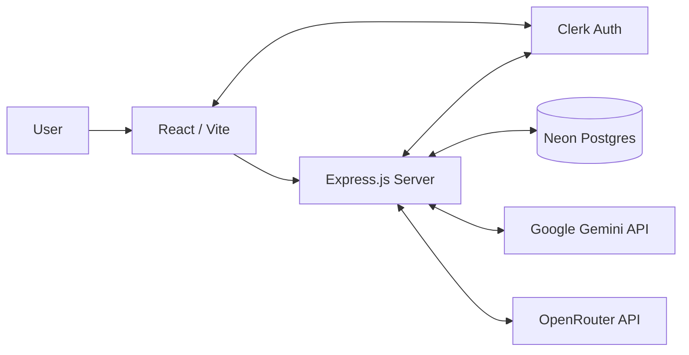

# Promptix.ai

Promptix.ai is a GenAI-powered SaaS platform designed to enhance productivity through intelligent AI chat, document analysis (PDF/DOCX), multi-pass resume reviews, and a community-driven prompt template library.


---

## Table of Contents

1. [Overview](#overview)
2. [Features & Current Implementation Status](#features--current-implementation-status)
3. [Architecture](#architecture)
4. [Tech Stack](#tech-stack)
5. [Project Structure](#project-structure)
6. [Frontend Architecture](#frontend-architecture)
7. [Backend Architecture](#backend-architecture)
8. [GenAI Architecture](#genai-architecture)
9. [Authentication & Authorization](#authentication--authorization)
10. [Database Overview](#database-overview)
11. [API Overview](#api-overview)
12. [Data Flow (Chat Workflow)](#data-flow-chat-workflow)
13. [Engineering Trade-offs](#engineering-trade-offs)
14. [Known Limitations](#known-limitations)
15. [Roadmap / Remaining Work](#roadmap--remaining-work)
16. [Local Development Setup](#local-development-setup)
17. [Interview Discussion Guide](#interview-discussion-guide)

---

## Overview

Promptix.ai solves the problem of fragmented AI tools by bringing chat, document QA, and specialized AI agents (like a resume reviewer) into a single SaaS interface. Target users include job seekers, professionals, and creators who need a unified AI workspace.

---

## Features & Current Implementation Status

| Feature | Status | Notes |
| :--- | :--- | :--- |
| **Authentication** | ✅ Complete | Handled via Clerk (JWT based). Integrated on client and server. |
| **AI Chat (Streaming)** | ✅ Complete | Uses Gemini 2.0 Flash with Server-Sent Events (SSE). |
| **Thread Management** | ✅ Complete | Users can create, delete, and switch between chat threads. |
| **Chat with PDF** | ✅ Complete | Extracts text and uses Gemini's 1M context window (skips embeddings). |
| **Resume Review** | ✅ Complete | Multi-pass analysis using OpenRouter for structured JSON feedback. |
| **Prompt Templates** | ✅ Complete | Browse and search templates, tracks usage counts. |
| **Usage Limits/Billing** | 🟡 Partial | Basic free usage tracking exists in Clerk user metadata. |
| **Testing** | 🔴 Not Implemented | No automated tests currently exist in the repository. |

---

## Architecture

Promptix.ai uses a modern decoupled Client/Server architecture.



---

## Tech Stack

| Layer | Technology | Why |
| :--- | :--- | :--- |
| **Frontend** | React 19, Vite, Tailwind CSS | Fast development, modular components, modern styling. |
| **Routing** | React Router DOM v7 | Standard declarative routing for React. |
| **Backend** | Express.js (Node.js) | Lightweight, unopinionated, fast to iterate on API routes. |
| **Database** | Neon Serverless Postgres | Scales to zero, easy connection pooling, SQL reliability. |
| **Auth** | Clerk (`@clerk/clerk-react`, `@clerk/express`) | Drop-in secure auth, manages sessions and user metadata natively. |
| **AI Providers** | Google Gemini & OpenRouter | Gemini for long-context (1M) and streaming; OpenRouter for cheap/free model fallback. |

---

## Project Structure

```text
Promptix.ai/
├── client/                 # Frontend React Application
│   ├── src/
│   │   ├── components/     # Reusable UI components
│   │   ├── hooks/          # Custom React hooks (e.g., useApi)
│   │   ├── pages/          # Route-level components (AI Chat, Resume, etc.)
│   │   └── App.jsx         # App routing and Auth wrappers
│   └── package.json
│
├── server/                 # Backend Express Application
│   ├── configs/            # DB configuration
│   ├── controllers/        # Request handlers (chat, pdf, resume, template)
│   ├── middlewares/        # Custom middleware (Clerk auth verification)
│   ├── routes/             # Express route definitions
│   ├── services/           # Business logic & external API wrappers (Gemini, OpenRouter, PDF parse)
│   ├── server.js           # Server entry point
│   └── package.json
└── README.md
```

---

## Frontend Architecture

The frontend is built as a Single Page Application (SPA).

- **Routing & Auth Guards:** Uses React Router. Protected routes (`/ai/*`) are wrapped in Clerk's `<SignedIn>` and `<SignedOut>` components, automatically redirecting unauthenticated users.
- **State Management:** Relies heavily on local React state (`useState`, `useEffect`) and custom hooks (like `useApi` for authenticated fetching).
- **Streaming UI:** The chat interface maintains an `isStreaming` state. It decodes the Server-Sent Events (SSE) stream in real-time, incrementally updating the active message in state without blocking the UI.
- **Styling:** Uses TailwindCSS along with Framer Motion for animations. 

---

## Backend Architecture

The backend follows a standard Controller-Service pattern to keep routes clean.

1. **Routes:** Map HTTP verbs to Controller functions.
2. **Middleware:** Clerk middleware validates JWTs and attaches user IDs to the request (`req.auth()`). Custom middleware attaches metadata like `plan` and `free_usage`.
3. **Controllers:** Handle HTTP requests, extract parameters, perform DB queries via the `@neondatabase/serverless` SDK, and format responses.
4. **Services:** House complex logic. `geminiService.js` manages Gemini API streaming, `aiService.js` manages OpenRouter calls, and `pdfService.js` handles file text extraction (using `pdf-parse` and `mammoth`).

---

## GenAI Architecture

Promptix.ai implements distinct AI strategies based on the feature:

### Standard Chat & PDF RAG (Gemini 2.0 Flash)
- **Streaming:** The chat utilizes Gemini's `sendMessageStream`.
- **Context Handling:** The backend loads the last 20 messages from the database to construct the `history` array, preventing token bloat while maintaining conversational context.
- **Document Analysis:** Instead of traditional chunking and embeddings (which were originally planned but skipped due to model limitations), the app extracts the full text of a PDF and injects up to 300,000 characters directly into Gemini's massive 1M context window.

### Resume Review (OpenRouter / OpenAI SDK)
- **Multi-pass Analysis:** To ensure high-quality, structured output, the `resumeController` fires **three parallel AI requests**:
  1. ATS Score & Keyword Match
  2. Section-by-section Quality Check
  3. Overall Impact & Formatting
- All three requests enforce JSON responses (`response_format: { type: "json_object" }`).

---

## Authentication & Authorization

- **System:** Clerk.
- **Flow:** Users authenticate on the client. Clerk stores a secure HttpOnly cookie / local token.
- **API Protection:** The backend uses `@clerk/express` `clerkMiddleware()`. Custom `auth.js` middleware ensures `req.auth().userId` exists before allowing access to AI endpoints, preventing unauthorized API consumption.
- **Metadata:** User plans (e.g., "free" vs "premium") and usage counters are stored securely in Clerk's `privateMetadata`.

---

## Database Overview

- **Provider:** Neon (Postgres)
- **Driver:** `@neondatabase/serverless` using raw SQL template tags (`sql\``).
- **Key Entities:**
  - `chat_threads`: Manages conversation sessions (`id`, `user_id`, `title`).
  - `chat_messages`: Stores individual chat bubbles (`id`, `thread_id`, `role`, `content`).
  - `pdf_files`: Tracks uploaded documents (`id`, `user_id`, `file_name`, `status`, `full_text`).
  - `resume_reviews`: Stores parsed JSON feedback (`id`, `user_id`, `file_name`, `ats_score`, `analysis`).
  - `prompt_templates`: Library of community prompts.

---

## API Overview

| Method | Endpoint | Purpose | Auth |
| :--- | :--- | :--- | :--- |
| `GET` | `/api/chat/threads` | List user's chat sessions | Required |
| `POST` | `/api/chat/threads/:id/stream`| Send a message and receive SSE stream | Required |
| `POST` | `/api/pdf/upload` | Upload PDF and start extraction | Required |
| `POST` | `/api/pdf/query` | Ask a question about the PDF (SSE) | Required |
| `POST` | `/api/resume/analyze` | Run multi-pass resume review | Required |
| `GET` | `/api/templates` | Fetch prompt templates | Public |

---

## Data Flow (Chat Workflow)

```text
User Input -> ChatInput Component
   ↓
Client `sendMessage()` -> Appends optimistic 'user' message
   ↓
API Request -> `POST /api/chat/threads/:id/stream`
   ↓
Clerk Middleware -> Validates user JWT
   ↓
`chatController` -> Saves 'user' message to DB
   ↓
`chatController` -> Fetches previous 20 messages for context
   ↓
`geminiService` -> Calls Gemini API with history
   ↓
Gemini API -> Yields text chunks
   ↓
`chatController` -> Sends `text/event-stream` (SSE) chunks to client
   ↓
Client -> Decodes SSE, updates UI incrementally
   ↓
(Stream completes) -> `chatController` saves 'model' message to DB
```

---

## Engineering Trade-offs

1. **Full-Context PDF vs. Embeddings/Vector DB:** 
   - *Decision:* Injecting full text into Gemini instead of chunking and vector search (Pinecone/PGVector).
   - *Why:* Gemini 2.0 has a 1M token context window. The developer's current API key lacked embedding access. 
   - *Trade-off:* Saves architectural complexity and DB costs, but increases LLM token costs drastically per query.
2. **Raw SQL vs. ORM:**
   - *Decision:* Using `@neondatabase/serverless` raw SQL tags instead of Prisma/Drizzle.
   - *Why:* Faster setup, less overhead for a simple schema.
   - *Trade-off:* Lacks type-safety and automatic migrations.
3. **SSE vs WebSockets:**
   - *Decision:* Server-Sent Events for chat streaming.
   - *Why:* Unidirectional data flow from server to client is sufficient for LLM generation. Easier to scale horizontally than WebSockets.

---

## Known Limitations

- **No automated testing:** Relies entirely on manual testing.
- **Rate Limiting:** No application-level rate limiting exists outside of catching provider 429s.
- **Cost Controls:** `aiController` implements a rudimentary 50-use limit, but standard chat and PDF queries currently lack strict token budgeting.
- **Error Handling:** PDF parsing can fail silently on large/corrupt PDFs without notifying the user immediately on the frontend (relies on polling).

---

## Roadmap / Remaining Work

### P0 — Critical
- [ ] Implement global application-level rate limiting (e.g., Redis + express-rate-limit).
- [ ] Add strict token limit checks for free-tier users across all chat endpoints.

### P1 — Important
- [ ] Add unit tests for `geminiService` and `resumeController`.
- [ ] Move from raw SQL to an ORM (like Drizzle) for better type safety.

### P2 — Nice to Have
- [ ] Implement actual vector embeddings for RAG to save on token costs for large PDFs.

---

## Local Development Setup

### Prerequisites
- Node.js (v18+)
- A Neon Postgres Database
- API Keys for Clerk, Gemini, and OpenRouter

### Environment Variables
Create a `.env` file in both `client` and `server`.

**`client/.env`**
| Variable | Required | Description |
| :--- | :--- | :--- |
| `VITE_CLERK_PUBLISHABLE_KEY` | Yes | Clerk public auth key |
| `VITE_API_URL` | Yes | Backend URL (e.g., `http://localhost:3000`) |

**`server/.env`**
| Variable | Required | Description |
| :--- | :--- | :--- |
| `CLERK_SECRET_KEY` | Yes | Clerk backend secret |
| `DATABASE_URL` | Yes | Neon Postgres connection string |
| `GEMINI_API_KEY` | Yes | Google Generative AI key |
| `OPENROUTER_API_KEY` | Yes | OpenRouter key (for resume parsing) |
| `CLIENT_URL` | Yes | Frontend URL for CORS |

### Installation & Running

1. **Clone & Install:**
   ```bash
   cd client && npm install
   cd ../server && npm install
   ```
2. **Start Backend:**
   ```bash
   cd server
   npm run dev
   ```
3. **Start Frontend:**
   ```bash
   cd client
   npm run dev
   ```

---

## Interview Discussion Guide

### 30-Second Explanation
"Promptix.ai is a GenAI-powered SaaS application I built that centralizes AI tools for professionals. It features real-time streaming chat, document Q&A, and a multi-pass AI resume reviewer. It is built with React, Express, Neon Postgres, and integrates models from Google Gemini and OpenRouter."

### Key Technical Talking Points
- **Why Gemini?** I chose Gemini 2.0 Flash for its massive 1M token context window. This allowed me to bypass complex vector database setups (like Pinecone) for PDF analysis, heavily simplifying the MVP architecture by injecting full documents directly into the prompt.
- **Handling Hallucinations & Structured Data:** For the resume reviewer, I didn't want a generic text response. I implemented a multi-pass architecture running three parallel API calls enforcing JSON outputs. This guarantees structured data for UI rendering (Scores, Feedback, formatting grades) while reducing hallucination.
- **Scalability:** I used Server-Sent Events (SSE) instead of WebSockets for the chat. Since LLM responses are unidirectional (server to client), SSE is significantly lighter, easier to cache, and avoids the sticky-session complexities of WebSockets when scaling instances.

### What I Would Improve for Production
If I had another 4 weeks to take this to production, my main focus would be **Cost Control and Reliability**:
1. **Move to Vector Embeddings:** Dumping 100-page PDFs into the context window works, but it is too expensive at scale. I would introduce PGVector to chunk and embed documents.
2. **Observability:** I would add Winston/Pino for structured logging and integrate LangSmith or Helicone to track LLM latency, token usage, and costs per user.
3. **Billing Integration:** Hook up Stripe webhooks to sync subscription status with Clerk metadata to hard-enforce usage tiers.
